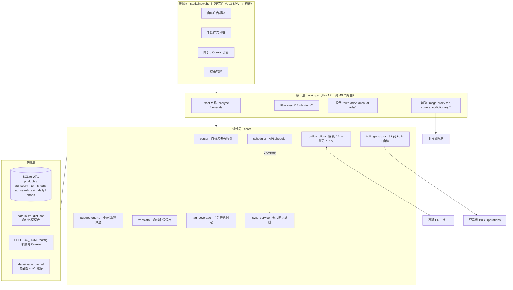

# 架构与维护约定

面向维护者：本文说明模块边界、数据流与「为什么必须这么做」。
功能与版本沿革见 [README](../README.md) / [CHANGELOG](../CHANGELOG.md)。

---

## 1. 设计原则

| 原则 | 具体含义 |
| --- | --- |
| **只加不改** | 曾有一版重写自动广告模块，导致商品图、竞价、预算、中位数排序全部丢失，用户明确反馈「这样根本就不能使用了」。此后任何版本升级必须以稳定前端为基底**逐行保留、只在外层追加**。自动广告的稳定基线是 `c60aff0`（v10）。 |
| **双入口同源** | Excel 与本地库是同一份商品数据的两个入口，必须走同一套预算 / 中位数逻辑，否则口径漂移。 |
| **离线优先** | 名词匹配、Excel 解析、Bulk 生成永远不依赖网络；赛狐同步与接口创建是可选增强，失败不能阻塞离线路径。 |
| **纯逻辑可测** | 判定类逻辑（`budget_engine`、`ad_coverage`）不碰 IO，方便用合成数据单测。 |
| **数据不进仓库** | 数据库、Cookie、账号密码、Chrome profile 一律排除；推荐 `SELLFOX_HOME` 物理外置。 |
| **版本单一来源** | `main.__version__` 是唯一版本号，FastAPI 元数据与 `/api/health` 共用。 |

---

## 2. 分层



`core/paths.py` 是所有数据 / 配置路径的唯一出口，`database`、`translator`、
`scheduler`、`sellfox_client`、`main` 都从它取 `DATA_DIR` / `CONFIG_DIR` / `DB_PATH`。
设了 `SELLFOX_HOME` 就把整棵数据目录搬到项目外，未设时行为与旧版一致。

---

## 3. 模块职责

| 模块 | 职责 | 不要在这里做 |
| --- | --- | --- |
| `parser.py` | 赛狐导出表表头嗅探、别名库、按值密度选列、多店铺分层 | 不要写业务预算规则 |
| `budget_engine.py` | 价格中位数、`build_shop_payload`、加权预算池（纯函数） | 不要读数据库 |
| `bulk_generator.py` | 生成官方 31 列 Bulk、手动关键词 Bulk、`_validate_output()` 自检 | 不要发网络请求 |
| `translator.py` | 首字符倒排索引、长词/位置优先、词库热重载 | 不要调翻译 API |
| `database.py` | 建表 / 迁移（`_ensure_column`）、商品与报表读写、父 SKU 映射、日期计数 | 不要放业务判定 |
| `sellfox_client.py` | 双协议（`post_json` CPC 网关 / `post_form` 商品）、Cookie 池、`build_auto_ad_payload` / `create_sp_ad` | 不要做跨账号编排 |
| `sync_service.py` | 账号 → 店铺 → 日期的分片同步编排、增量去重 | 不要自己拼路径 |
| `ad_coverage.py` | 活动状态 / SKU 归一化 / 覆盖判定 / 合并正则兜底（纯逻辑 + 取数） | 不要依赖 FastAPI |
| `scheduler.py` | 定时任务注册与启停 | 不要写同步逻辑 |
| `main.py` | 路由、请求模型、缓存与降级、启动 | 不要塞核心算法 |

前端全部在 `static/index.html`（约 3200 行），Vue 3 + TailwindCSS 走 CDN，
**没有 npm / 构建步骤**。改前端后必须重启服务，否则浏览器拿到的是旧文件。

---

## 4. 关键数据流

### 4.1 商品数据双入口（必须同构）

```
Excel  ──POST /api/analyze──▶ parser → build_shop_payload ─┐
                                                          ├─▶ {shops:{店名:{median_price,total_parents,products[]}}}
本地库 ─GET /api/products/{id}/payload─▶ build_shop_payload┘
```

两条路径都调用 `core/budget_engine.build_shop_payload`。任何一侧另写一套中位数或
建议预算算法，都会导致同一个商品在 Excel 与本地库里显示不同预算。

### 4.2 同步链路

```
sync_all_accounts(kind, days, account_ids)
  └─ 每个账号 use_account(aid)                 # ContextVar 隔离 Cookie
      └─ 探测「该账号可访问的店铺」→ 过滤 shops.account_id
          └─ 每店铺 × 每日期 调 sync_search_terms_for_shop
              ├─ 本地已有该日期 → 跳过（count_rows_for_date）
              ├─ campaignIdList=[]（空数组 = 全店铺，单店 153s → 6.8s）
              └─ 分页按「本页行数 < pageSize」判断（totalSize 恒为 0）
```

> 商品同步必须**逐店铺**拉；搜索词必须**按店铺分片**拉。
> 全账号一次拉会被 `max_pages` 截断 / 因赛狐排序不稳定漏 5%~19% 行。

### 4.3 广告覆盖判定

```
GET /api/shops/{id}/ad-coverage
  ├─ 10 分钟内存缓存 + threading.Lock 单飞
  ├─ 取 enabled 活动（2204 → 291）及其广告商品
  ├─ 广告商品 sku → db.get_parent_sku_map() → 父 SKU → 标 enabled
  ├─ 活动名兜底：N 个父 SKU 合成一条交替正则 + 整词边界
  └─ 结果 {父SKU: {enabled, state, campaigns[], paused_campaigns[]}}
     失败返回 ok=false，前端显示「未知」，不抛错、不阻塞表格
```

只有 `state == enabled` 算开启；`paused` / `archived` 不算。

### 4.4 投放产出

```
自动广告：商品 → generate_bulk_excel（Bulk）  或  create-via-api → build_auto_ad_payload → create_sp_ad
手动广告：搜索词/ASIN 行 → generate_manual_keyword_bulk（Bulk） 或 create_manual_via_api
          └─ 混合关键词 + 商品投放时自动拆成「原活动」+「原活动_ASIN」两次请求
```

赛狐 `spTargetInfo.keywordTarget` 是二选一开关（`True + keywords[]` /
`False + targetings[]`）；**Bulk 导出不受此限制**，亚马逊允许同一广告组里
Keyword 与 Product Targeting 共存。

---

## 5. 数据模型

SQLite（WAL），四张主表：

| 表 | 唯一键 | 用途 |
| --- | --- | --- |
| `shops` | `shop_id` | 店铺注册表；`account_id` 由 `_ensure_column` 迁移追加，标识归属赛狐账号 |
| `products` | `(shop_id, msku, asin)` | 商品库；`parent_sku` 是父体聚合键，`raw_title` / `clean_zh_name` / `price` / `image_url` |
| `ad_search_terms_daily` | `(report_date, shop_id, search_term, campaign_id, match_type)` | 用户搜索词维度；`asin` / `msku` 指**自家广告商品**（来自 `adProduct` 映射） |
| `ad_search_asin_daily` | 按日期 + 店铺 + 目标 ASIN | 投放产生 ASIN 维度，与搜索词表分开存，避免污染唯一键 |

表结构变更一律用 `_ensure_column(conn, table, column, ddl)` 做幂等迁移，
**不要直接改 `CREATE TABLE`**（旧库不会重建）。

---

## 6. 不能踩的坑（都是线上事故换来的）

| # | 约定 | 原因 |
| --- | --- | --- |
| 1 | Bulk 表 **32 列 = 官方 31 列 + 辅助列 `ASIN`** | 32 列是设计，不是 bug；亚马逊忽略辅助列 |
| 2 | `_plan_temp_ids()` 以 `parent_sku` 去重，只适用「一父体一活动」的自动广告 | 手动广告支持「同父体、每搜索词一活动」，必须在 `generate_manual_keyword_bulk` 内按 campaign 序号单独分配 ID，否则多个活动共用编号被亚马逊合并 |
| 3 | Create 的实体编号必须是**非纯数字文本** | 纯数字被当成真实活动 ID，整表被拒；v10 起加 `c` 前缀并本地自检 |
| 4 | 手动广告竞价基准用 `cpc`，不用 `suggested_bid` | 自动搜索词行 suggested 恒为 0（实测 25/25 有 CPC，仅 1/25 有建议竞价） |
| 5 | `get_account(aid)` 找不到必须返回 `None`，**绝不回退 active** | 回退会用错账号的 Cookie，表现为「搜索词少几个 / ASIN 查不到」的串号 |
| 6 | 来源活动名分隔符**主要是空格** | 只按 `- _ ー` 切会整段切不动，名字里残留「手动_手动」 |
| 7 | 商品图必须走 `/api/image-proxy` | 浏览器直连 `m.media-amazon.com` 常被防盗链拦截，表现为白块；代理有 5 域名白名单，防 SSRF |
| 8 | `main.py` = CRLF，`static/index.html` = LF | 编辑工具会翻转行尾，让 `git diff` 变成整文件重写、无法按主题拆提交 |
| 9 | 用项目 `venv/Scripts/python.exe` 跑测试 | 系统 Python 缺 `apscheduler` / `numpy`，会让 `test_5` 误报失败 |
| 10 | `start.bat` 会 kill 8000 端口旧进程再启动 | 后台验证服务容易被顶掉（报 exit 1），不是崩溃 |

---

## 7. 测试策略

```bash
bash tests/run_all.sh                 # 7 个脚本，291 条断言（test_4 需后端在跑）
PYTHONPATH="$(pwd)" venv/Scripts/python.exe tests/test_7_multi_account.py
```

| 层次 | 脚本 | 保障目标 |
| --- | --- | --- |
| 纯逻辑 | `test_1` `test_3` `test_8` | 名词匹配、词库 IO、广告覆盖判定 |
| 端到端 | `test_2` `test_5` | 表头与官方模板逐字比对、临时 ID、字段合规、rematch 契约 |
| 接口 | `test_4` | HTTP 冒烟（需服务运行） |
| 前端 | `test_6` | jsdom + 真实 Vue 运行时的交互回归 |
| 隔离 | `test_7` | 多账号不串号 |

`test_2` 会把 `BULK_COLUMNS` 与 `samples/AdvertisingBulksheetTemplate-seller.xlsx`
的官方表头逐字比对，这是防止「生成了才发现被亚马逊整表拒绝」的最后一道闸。
演示数据 `samples/fixtures/sellfox_export_demo.xlsx` 是**全合成**的，
clone 后无需任何真实业务数据即可跑通全部测试。

---

## 8. 扩展指引

- **加新同步源**：在 `sync_service` 编排，`sellfox_client` 只负责单账号单次请求；
  新报表单独建表，不要塞进 `ad_search_terms_daily` 的唯一键里。
- **加新投放类型**：先确认 Bulk 侧能否表达（受控值 / 列位置），
  再决定是否接接口创建；`_validate_output()` 的白名单要同步放行。
- **改前端**：先把 `git show c60aff0:static/index.html` 相关模块导出做基底，
  只追加不重写；改完重启服务验证。
- **发版**：按 [Release Notes 末尾的发布清单](RELEASE_NOTES_v2.7.0.md#7-维护者发布清单) 执行。
